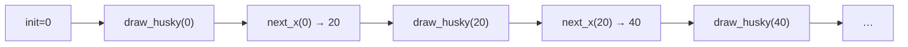

import { ClassDate } from '@site/src/components/DateView/DateView';

Date: <ClassDate />

:::info[Reference]

Every part of a reactor, and how to test one, is on the [Reactors](/pll/reactors) page.

:::

## Skills: [0](</skills/#0>), [1](</skills/#1>)

## Notes (review before class)
### Animations Are Frames

What we know already is enough to build animations, and programs that react to
the keyboard and mouse. Here is a husky, heading home to its doghouse:


- Try: before reading on, what in the picture moves, and what stays put?
- An animation is a sequence of images, called **frames**, shown quickly one
  after another: the motion is an illusion.

| Frame 1 | Frame 2 | Frame 3 |
| :---: | :---: | :---: |
|  |  |  |

The pictures, and the sizes of the scene:

```python
HUSKY_URL = (
    "https://raw.githubusercontent.com/neu-pdi/cs2000-public-resources/refs/heads/main/static/img/lab5-husky.png"
)
DOGHOUSE_URL = (
    "https://raw.githubusercontent.com/neu-pdi/cs2000-public-resources/refs/heads/main/static/img/lab5-doghouse.png"
)
BACKGROUND_URL = (
    "https://raw.githubusercontent.com/neu-pdi/cs2000-public-resources/refs/heads/main/static/img/lab5-background.png"
)

husky = scale(0.6, load_image(HUSKY_URL))
doghouse = scale(0.6, load_image(DOGHOUSE_URL))
background = load_image(BACKGROUND_URL)

HEIGHT = 400
WIDTH = 750
DOGHOUSE_X = WIDTH - 120
GROUND_Y = HEIGHT - 90
```

- `load_image` loads a picture from the web (or from a file next to your
  program). After that, it is an `Image` like any other.
- `place_image(i, x, y, scene)` puts `i` on `scene` with `i`'s _center_ at
  `(x, y)`. The point `(0, 0)` is the scene's _top left_ corner: `x` grows to
  the right, and `y` grows _down_.

One frame, with the husky at `x` = 100:

```python
place_image(husky, 100, GROUND_Y,
            place_image(doghouse, DOGHOUSE_X, GROUND_Y, background))
```

- `place_image` calls nest: the doghouse goes on the background, then the
  husky on that.
- Try: which part of this expression changes from one frame to the next?

### A Function for Each Frame

Only the husky's `x` changes, so it becomes the parameter:

```python
def draw_husky(x: float) -> Image:
    """the scene, with the husky at x and on the ground"""
    return place_image(husky, x, GROUND_Y,
                       place_image(doghouse, DOGHOUSE_X, GROUND_Y, background))
```

- `draw_husky` has no tests. A test's expected image would repeat the body's
  image-building code, so it would check nothing: we don't test functions that
  make images.
- Its frames: `draw_husky(0)`, `draw_husky(20)`, `draw_husky(40)`, and so on.
  The step from each `x` to the next is the same computation every time, so
  it's a function too:

```python
def next_x(x: float) -> float:
    """the husky's x in the next frame: 20 to the right"""
    return x + 20

def test_next_x():
    assert next_x(0) == 20
    assert next_x(100) == 120
```

With a first `x`, these two functions _define_ the animation: draw, step, draw,
step, ...

### Reactors

A **reactor** is the value that runs them. It is given each of its parts by
name, and `.interact()` starts it:

```python
husky_run = reactor(
    init=0,
    to_draw=draw_husky,
    on_tick=next_x,
)

husky_run.interact()
```

- `init` is the starting **state**: the one piece of information that changes
  from frame to frame (here, the husky's `x`).
- `to_draw` is a function from the state to the frame's image.
- `on_tick` is a function from the state to the next state. The reactor calls
  it on every tick of its clock, many times a second.



- The husky runs past its doghouse and off the screen: `x` just keeps growing.
- Try: what would you change to make it run slower?

### Functions Called for You

Until now, we wrote functions to name a computation, and called them
ourselves. Here, we never call `draw_husky` or `next_x`: we hand them to the
reactor, and _it_ calls them, whenever it needs a frame or a tick. The reactor
knows how to run an animation; only we know what ours should look like, and
the functions are how we tell it.

So each part is a function with a fixed contract: `to_draw` takes a state and
returns an `Image`; `on_tick` takes a state and returns a state.

### Reacting to Keys

An **interactive** program changes the state when someone does something. A
reactor's `on_key` is a function from the state and a key to the new state.
Here, pressing `r` sends the husky back to the start:

```python
def restart(x: float, key: str) -> float:
    """back to the start (x = 0) when the key is "r"; otherwise, x as it was"""
    if key == "r":
        return 0
    return x

def test_restart():
    assert restart(300, "r") == 0
    assert restart(300, "a") == 300

husky_keys = reactor(
    init=0,
    to_draw=draw_husky,
    on_tick=next_x,
    on_key=restart,
)

husky_keys.interact()
```

- `key` is a string: `"a"`, `"r"`, `" "` for the space bar, and `"left"`,
  `"right"`, `"up"`, `"down"` for the arrows.
- Click the picture before typing, so that the keys go to the reactor, and not
  to the interactions prompt.
- `restart` returns a number, so it has tests, like any function: its examples
  are easier to read than its `if`.
- Other parts: `on_mouse` (a function of the state, the mouse's `x` and `y`,
  and what it did), and `stop_when` (a function from the state to a `bool`:
  when it returns `True`, the reactor stops). All of them are on the
  [Reactors](/pll/reactors) page.

## Live

A short lecture builds the husky animation from the Notes, one frame, then one
function, then the reactor. Then a worksheet, in pairs: for a reactor and a
list of things that happen (ticks, keys), which function runs each time, and
what the state becomes. Then, in pairs at a laptop, you make the husky hop back
when a key is pressed, and stop at its doghouse.

## Practice

Start each from the Notes' husky (your file from class has it).

1. Make the husky run slower, then faster, in two different ways: by changing
   `next_x`, and by giving the reactor a `tick_rate` (the number of seconds
   between ticks).
1. Once the husky reaches its doghouse, show a different frame: the same scene
   with a message (`text`), or the doghouse alone, with the husky inside. You'll
   need a function that says whether the husky is at the doghouse, and an `if`
   in `draw_husky`.
1. Make the husky run home the other way: start it at the right edge, put the
   doghouse near the left one, and have it stop when it gets there.
1. Design `jump_to`, for `on_mouse`: when the mouse button goes down
   (`"button-down"`), the husky jumps to the mouse's `x`; anything else leaves
   it where it is. Its signature is
   `jump_to(x: float, mouse_x: float, mouse_y: float, event: str) -> float`.
1. A traffic light: a reactor whose state is the color that is lit, `"green"`,
   `"yellow"`, or `"red"`. Design `next_light`, which gives the color after a
   tick (green, then yellow, then red, then green again), and a `draw_light`
   that draws it, and run it with `tick_rate=1`.
1. Without watching it: use `simulate_trace` and `get_trace` (on the
   [Reactors](/pll/reactors) page) to test that `husky_run`'s first four states
   are `[0, 20, 40, 60]`.
